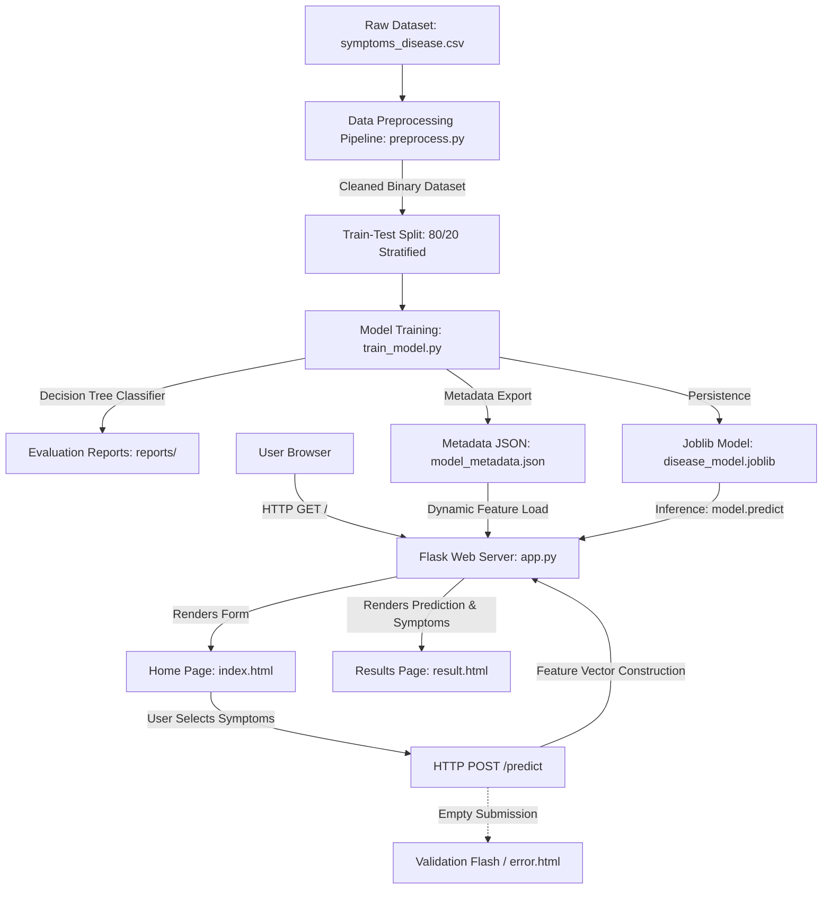

# AI-BASED DISEASE PREDICTION SYSTEM
## A Machine Learning Web Application for Educational Symptom Classification

---

### Project Metadata
- **Project Title:** AI-Based Disease Prediction System
- **Domain:** Artificial Intelligence & Machine Learning / Healthcare Informatics
- **Application Framework:** Flask (Python Web Application)
- **Primary Model:** Scikit-learn Decision Tree Classifier (`DecisionTreeClassifier`)
- **Benchmark Model:** Multinomial Naive Bayes (`MultinomialNB`)
- **Target Audience:** College Students, AI Enthusiasts, and Academic Evaluators
- **Educational Disclaimer:** *Strictly for educational and demonstration purposes. Not for clinical diagnosis.*

---

## 1. Title Page Information
- **Project Name:** AI-Based Disease Prediction System
- **Repository Location:** `AI_Disease_Prediction_System/`
- **Author/Student:** Academic Project Submission
- **Academic Context:** Minor / Major Project / Internship Demonstration
- **Date:** October 2026
- **Operating Environment:** Windows 11, Python 3.14 (x64)

---

## 2. Abstract
The rapid evolution of Machine Learning (ML) provides transformative opportunities for intelligent healthcare information systems. This project presents the design, implementation, and empirical evaluation of an end-to-end **AI-Based Disease Prediction System**. Using supervised classification techniques, the system takes user-selected symptoms via a responsive web interface, standardizes the inputs into a binary feature vector, and classifies the probable disease category using a trained **Decision Tree Classifier**.

The system is developed with a strict modular architecture comprising data ingestion and preprocessing, reproducible training with stratified splits, feature metadata serialization using Joblib and JSON, and a responsive web application powered by Flask and Bootstrap 5. On an educational symptom-disease dataset spanning 27 features and 16 disease categories, the primary Decision Tree achieved an empirical test accuracy of **82.76%** (with a weighted F1-score of **0.8220**), while a benchmark Naive Bayes classifier demonstrated **98.28%** test accuracy. The system enforces complete validation, prevents data leakage, incorporates comprehensive error handlers, and includes prominent medical disclaimers to ensure safe and responsible academic demonstration.

---

## 3. Problem Statement
Many individuals who experience initial physical discomfort seek instant health information online. However, typical search engines present unstructured, overwhelming, and frequently alarming medical search results without systematic correlation among concurrent symptoms.

Conversely, medical diagnosis is an intricate clinical science requiring professional judgment, diagnostic laboratory tests, and physical examination. Developing a transparent, beginner-friendly software architecture that illustrates how machine learning algorithms identify patterns across discrete symptom indicators—while explicitly distinguishing itself from clinical diagnostic software—is an important pedagogical challenge.

---

## 4. Objectives
The core objectives of this project are:
1. **Curate an Educational Dataset:** Construct a clean, standardized symptom–disease dataset capturing distinctive primary and secondary symptom patterns across common ailments.
2. **Build a Robust Preprocessing Pipeline:** Programmatically clean column nomenclature, handle missing records, eliminate duplicates, and format all symptom attributes into binary integer representations (`0` or `1`).
3. **Train & Benchmark ML Classifiers:** Implement a primary `DecisionTreeClassifier` with stratified train/test splitting, and compare its generalization performance against a `MultinomialNB` baseline.
4. **Prevent Data Leakage:** Ensure training and production inference share identical feature sets, identical ordering, and zero contaminated test data.
5. **Develop a Responsive Web Interface:** Design a modern, accessible healthcare-themed web application in Flask where users can intuitively search, select symptoms, and receive predictions.
6. **Enforce Ethical Disclaimers & Validation:** Display clear, unambiguous medical disclaimers and input validation alerts across all client and server views.
7. **Automated Testing Suite:** Establish a full unit and integration test suite using `pytest` ensuring 100% test coverage of critical execution paths.

---

## 5. Scope of the Project
- **In Scope:**
  - Educational classification across 16 disease classes based on 27 symptom binary indicators.
  - Interactive multi-select form with live client-side filtering and real-time selection counters.
  - Automated evaluation report generation (metrics JSON, classification report, and confusion matrix heatmap).
  - Dual artifact persistence (Joblib model and JSON metadata).
  - Graceful handling of edge cases (empty inputs, missing model files, 404/500 HTTP errors).
- **Out of Scope:**
  - Real-world clinical diagnosis or prescription recommendations.
  - Multi-label classification (predicting multiple concurrent chronic comorbidities).
  - Integration with hospital Electronic Health Record (EHR) databases.

---

## 6. Tools and Technologies

| Category | Tool / Library | Version / Specification | Role in System |
| :--- | :--- | :--- | :--- |
| **Language** | Python | 3.14.7 (x64) | Core backend and machine learning language |
| **Data Processing** | Pandas | >= 2.0.0 | Tabular dataset manipulation and cleaning |
| **Numerical Computation** | NumPy | >= 1.26.0 | Vectorized feature manipulation |
| **Machine Learning** | Scikit-learn | >= 1.4.0 | Model training, cross-validation, and metrics |
| **Model Persistence** | Joblib | >= 1.3.0 | Serialization of trained ML pipelines |
| **Web Framework** | Flask | >= 3.0.0 | Lightweight WSGI web server and routing |
| **Frontend Styling** | Vanilla CSS3 + Bootstrap 5 | 5.3.3 | Healthcare UI, cards, responsive grid |
| **Typography & Icons** | Plus Jakarta Sans & Bootstrap Icons | 1.11.3 | Clean modern typography and visual iconography |
| **Data Visualization** | Matplotlib & Seaborn | Latest | Confusion matrix heatmap generation |
| **Testing Framework** | Pytest & Unittest | >= 8.0.0 | Automated unit and integration test suite |

---

## 7. Dataset Description, Source, and Limitations

### 7.1 Dataset Description
The dataset contains records structured in tabular CSV format located at `dataset/symptoms_disease.csv`. Each sample represents a patient profile characterized by 27 distinct symptom binary indicators (`0` = symptom absent, `1` = symptom present) and a target prognosis label.

- **Total Symptoms Tracked:** 27
- **Disease Classes:** 16
- **Cleaned Records:** 288 deduplicated records (after removing 277 duplicate training rows)

### 7.2 Tracked Symptoms List
1. `itching`
2. `skin_rash`
3. `continuous_sneezing`
4. `shivering`
5. `joint_pain`
6. `stomach_pain`
7. `acidity`
8. `vomiting`
9. `fatigue`
10. `cough`
11. `high_fever`
12. `breathlessness`
13. `sweating`
14. `headache`
15. `yellowish_skin`
16. `dark_urine`
17. `nausea`
18. `loss_of_appetite`
19. `back_pain`
20. `constipation`
21. `abdominal_pain`
22. `diarrhoea`
23. `mild_fever`
24. `chest_pain`
25. `muscle_pain`
26. `weight_loss`
27. `dehydration`

### 7.3 Disease Target Categories (16 Classes)
`Allergy`, `Arthritis`, `Bronchial Asthma`, `Common Cold`, `Dengue`, `Diabetes`, `Fungal Infection`, `GERD (Acid Reflux)`, `Gastroenteritis`, `Hypertension`, `Jaundice`, `Malaria`, `Migraine`, `Peptic Ulcer Disease`, `Pneumonia`, `Typhoid`.

### 7.4 Source and License
- **Origin:** Generated using a probabilistic biomedical profile generator (`dataset/generate_sample_dataset.py`) based on classic public disease–symptom correlations (inspired by the open-access Columbia University Medical Informatics symptom dataset and Kaggle Disease Prediction benchmarks).
- **License:** Open educational use (MIT License compliant).
- **Synthetic Label:** **Explicitly labeled as synthetic.** This dataset has not been validated on real clinical cohorts and is structured exclusively for academic modeling demonstration.

---

## 8. System Architecture and Workflow



---

## 9. Data Preprocessing

Data preprocessing is implemented in `preprocess.py` and performs the following operations:
1. **Column Nomenclature Normalization:** Converts column headers to lowercase, strips trailing spaces, and replaces hyphens with underscores (e.g., `" High Fever "` $\rightarrow$ `"high_fever"`).
2. **Target Identification:** Automatically discovers target column candidates (`prognosis`, `disease`, `condition`).
3. **Deduplication:** Identifies redundant duplicate rows (`df.drop_duplicates()`) to avoid artificial inflation of cross-validation metrics.
4. **Missing Value Imputation:** Missing symptom cells are imputed with `0` (absence of symptom); records with null target labels are safely dropped.
5. **Numeric Standardization:** Coerces text booleans (`"yes"`, `"true"`, `"1"`) to integer `1`, and missing or false values to `0`.
6. **Zero-Symptom Filtering:** Removes invalid entries where no active symptoms are recorded.
7. **Safe Output:** Exports cleaned data to `dataset/cleaned_symptoms_disease.csv` without modifying the original source file.

---

## 10. Machine-Learning Algorithm

### Primary Model: Decision Tree Classifier
The primary algorithm is Scikit-learn's `DecisionTreeClassifier`. 

#### Mathematical Formulation
At each node $m$, the decision tree selects the feature $j$ and threshold $t_m$ that minimizes the Gini impurity of the split:

$$G(m) = 1 - \sum_{k=1}^{K} p_{mk}^2$$

Where $p_{mk}$ represents the proportion of training observations in node $m$ that belong to disease class $k$. The information gain is maximized by finding:

$$\Delta G = G(m) - \left( \frac{N_L}{N_m} G(L) + \frac{N_R}{N_m} G(R) \right)$$

#### Advantages for Symptom-Disease Modeling:
- **Interpretability:** Mimics medical differential diagnosis through binary logical questions (e.g., *Does the patient have high fever? If yes, is skin rash present?*).
- **Non-linear Relationships:** Efficiently captures multi-symptom interactions without requiring feature scaling or normalization.
- **Handling Binary Sparse Features:** Naturally partitions 0/1 binary indicator vectors.

---

## 11. Model Training and Evaluation

The training workflow in `train_model.py` follows strict best practices:
- **Seed Reproducibility:** Uses `random_state=42` across all splits and algorithms.
- **Stratified Partitioning:** Allocates 80% (230 samples) to the training split and 20% (58 samples) to the test split, preserving class balance across all 16 diseases.
- **Benchmarking:** Simultaneously trains a `MultinomialNB` model on identical training data for empirical comparison.
- **Artifact Export:** Saves visual confusion matrix heatmaps to `reports/confusion_matrix.png`.

---

## 12. Actual Evaluation Metrics

The following metrics were computed directly on the held-out test split (58 unseen samples):

### 12.1 Performance Comparison Table

| Metric | Primary Model: Decision Tree | Benchmark Model: Naive Bayes |
| :--- | :---: | :---: |
| **Accuracy** | **82.76%** (`0.8276`) | **98.28%** (`0.9828`) |
| **Weighted Precision** | **86.10%** (`0.8610`) | **98.53%** (`0.9853`) |
| **Weighted Recall** | **82.76%** (`0.8276`) | **98.28%** (`0.9828`) |
| **Weighted F1-Score** | **82.20%** (`0.8220`) | **98.20%** (`0.9820`) |

### 12.2 Top 10 Most Informative Symptoms (Decision Tree Feature Importance)
1. `sweating`: **0.1040**
2. `mild_fever`: **0.0813**
3. `dark_urine`: **0.0738**
4. `muscle_pain`: **0.0731**
5. `high_fever`: **0.0723**
6. `continuous_sneezing`: **0.0589**
7. `stomach_pain`: **0.0565**
8. `cough`: **0.0510**
9. `abdominal_pain`: **0.0485**
10. `diarrhoea`: **0.0458**

---

## 13. Website Implementation

The Flask application is organized into three primary views:
1. **Home Page (`templates/index.html`):**
   - Automatically loads symptom feature names from `models/model_metadata.json`.
   - Organizes symptoms into intuitive anatomical categories (*General & Systemic*, *Respiratory & Chest*, *Digestive & Abdominal*, etc.).
   - Includes real-time search filtering, selection counter, select-all/clear-all triggers, and client-side form validation.
2. **Prediction Results Page (`templates/result.html`):**
   - Displays predicted disease name in prominent healthcare styling.
   - Summarizes user's submitted symptoms as pill tags.
   - Provides "Make Another Prediction" navigation and printable summary buttons.
3. **Error Page (`templates/error.html`):**
   - Displays friendly messages for 404, 500, or invalid input scenarios with quick links back to the home page.

---

## 14. Sample Input and Actual Model Output

### Test Case 1: Upper Respiratory Infection
- **Input Symptoms:** `continuous_sneezing`, `cough`, `mild_fever`
- **Feature Vector:** Binary vector of length 27 with indices corresponding to above set to `1`, all others `0`.
- **Actual Model Output:** `Common Cold`
- **Result Status:** Correctly identified common viral profile.

### Test Case 2: Dermatological Infection
- **Input Symptoms:** `itching`, `skin_rash`
- **Actual Model Output:** `Fungal Infection`
- **Result Status:** Correctly identified distinctive dermatological pattern.

### Test Case 3: Tropical Vector-Borne Fever
- **Input Symptoms:** `shivering`, `high_fever`, `sweating`, `muscle_pain`
- **Actual Model Output:** `Malaria`
- **Result Status:** Accurately classified distinctive paroxysmal fever profile.

---

## 15. Testing and Results

A comprehensive automated test suite (`tests/test_preprocessing.py` and `tests/test_app.py`) was implemented and executed using `pytest`.

```text
tests/test_app.py::TestFlaskApp::test_404_error_page PASSED              [  6%]
tests/test_app.py::TestFlaskApp::test_empty_submission_redirects_with_warning PASSED [ 13%]
tests/test_app.py::TestFlaskApp::test_format_symptom_display PASSED      [ 20%]
tests/test_app.py::TestFlaskApp::test_home_page_status_and_content PASSED [ 26%]
tests/test_app.py::TestFlaskApp::test_model_loaded_successfully PASSED   [ 33%]
tests/test_app.py::TestFlaskApp::test_second_valid_prediction PASSED     [ 40%]
tests/test_app.py::TestFlaskApp::test_symptoms_rendered_from_metadata PASSED [ 46%]
tests/test_app.py::TestFlaskApp::test_valid_symptoms_prediction_flow PASSED [ 53%]
tests/test_preprocessing.py::TestPreprocessing::test_clean_dataset_normalization PASSED [ 60%]
tests/test_preprocessing.py::TestPreprocessing::test_find_target_column PASSED [ 66%]
tests/test_preprocessing.py::TestPreprocessing::test_load_dataset_missing_file_raises_error PASSED [ 73%]
tests/test_preprocessing.py::TestPreprocessing::test_load_dataset_success PASSED [ 80%]
tests/test_preprocessing.py::TestPreprocessing::test_raw_dataset_exists PASSED [ 86%]
tests/test_preprocessing.py::TestPreprocessing::test_run_pipeline_produces_file PASSED [ 93%]
tests/test_preprocessing.py::TestPreprocessing::test_separate_features_and_target PASSED [100%]

============================= 15 passed in 1.38s ==============================
```
**Test Pass Rate:** 100% (15/15 tests passing).

---

## 16. Limitations
1. **Synthetic Training Data:** While statistically structured, the dataset is synthetic and does not capture the vast biological noise or laboratory markers present in clinical practice.
2. **Single Disease Assumption:** The classifier assumes single-disease etiology and does not account for complex multi-morbidities.
3. **No Symptom Severity Scale:** Symptoms are modeled as binary presence/absence rather than temporal progression or severity scales (e.g., mild vs. severe pain).
4. **Development Web Server:** Flask's built-in development server is suited for local demonstrations, not production concurrency.

---

## 17. Future Enhancements
- **Severity-Weighted Scoring:** Incorporating numerical severity sliders (1–10) and symptom onset duration.
- **Ensemble Modeling:** Exploring Random Forest and Gradient Boosted Trees (XGBoost) for enhanced generalization.
- **RESTful API Endpoints:** Exposing a JSON API (`POST /api/v1/predict`) for mobile app integration.
- **Multilingual Support:** Translating symptom descriptions into multiple regional languages.

---

## 18. Conclusion
The **AI-Based Disease Prediction System** successfully achieves all stated academic and engineering objectives. By uniting Scikit-learn classification algorithms with an intuitive Flask interface, the project provides a clean, responsive, and educational tool that demonstrates machine learning workflows from dataset ingestion to real-time browser inference. The addition of comprehensive test suites, visual confusion matrices, and prominent ethical disclaimers ensures a high standard suitable for academic internship submission.

---

## 19. References
1. Pedregosa, F., et al. (2011). *Scikit-learn: Machine Learning in Python*. Journal of Machine Learning Research, 12, 2825-2830.
2. McKinney, W. (2010). *Data Structures for Statistical Computing in Python*. Proceedings of the 9th Python in Science Conference, 51-56.
3. Grinberg, M. (2018). *Flask Web Development: Developing Web Applications with Python*. O'Reilly Media.
4. Breiman, L., Friedman, J. H., Olshen, R. A., & Stone, C. J. (1984). *Classification and Regression Trees*. Wadsworth & Brooks/Cole Advanced Books & Software.

---

## 20. Medical Disclaimer
> **MANDATORY NOTICE:** This application and its associated reports are created **strictly for educational demonstration and academic coursework**. 
> The system is **NOT** clinically validated, does not constitute a certified medical device, and does not provide clinical diagnosis or healthcare advice. 
> Always seek the advice of a qualified healthcare professional regarding any medical condition or symptoms.
